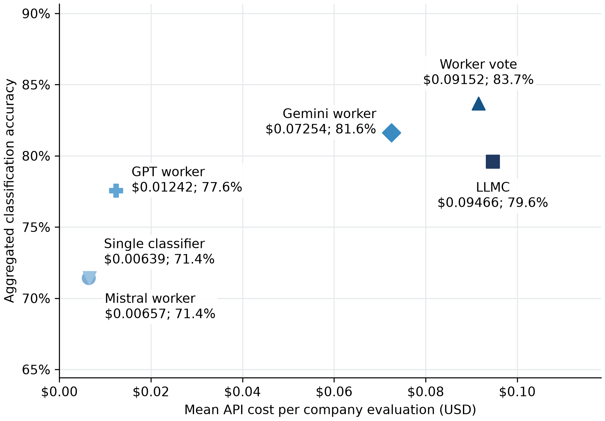
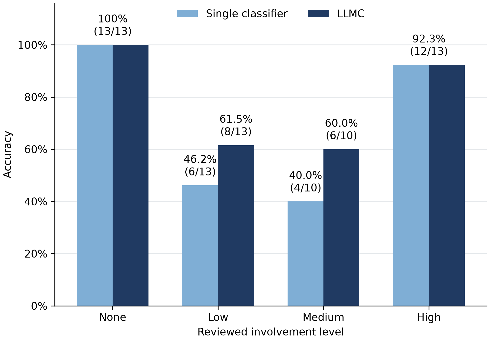

# 🧠 Multi-LLM Classification Council

**Classifying companies’ observable AI involvement from website text using a Single classifier and a multi-model council.**

---

## 📌 Description

This repository contains the code and saved results for a master's thesis comparing a **Single classifier** with a **Multi-Large Language Model Classification Council (LLMC)**.

Both approaches classify companies into four ordered AI involvement levels: **None, Low, Medium, and High**. The council uses three workers followed by a judge, which receives their structured outputs and supporting evidence.

The main evaluation covers **49 companies across three V2 repetitions**. Predictions are evaluated against human-reviewed reference labels for accuracy, consistency across runs, and recorded API cost.

---

## ✨ Key Features

- **Single and council classification** using the same frozen website inputs.
- **Three repeated evaluations** with saved outputs and support for resuming interrupted runs.
- **Worker voting and judge comparison**, including majority voting with an ordinal-median tie-break.
- **Performance analysis:** accuracy, macro precision/recall/F1, ordinal MAE, and an exact paired McNemar test.
- **Consistency analysis:** label flip rates and confidence score dispersion.
- **Cost analysis and figures**, exported as CSV tables and PNG/PDF charts.
- **Saved-results verification** without API credentials or paid model calls.

---

## ⚙️ Tech Stack

| Component | Purpose |
| --- | --- |
| Python 3.12 | Classification, preprocessing, and analysis |
| OpenRouter | Access to the classification models |
| Pydantic | Validation of structured model outputs |
| Requests and python-dotenv | API requests and local credential loading |
| Matplotlib | Charts and presentation tables |
| Lingua and tiktoken | Language detection and token counting during preprocessing |

### Models

| Role | Model ID |
| --- | --- |
| Single classifier and Mistral worker | `mistralai/mistral-small-2603` |
| GPT worker | `openai/gpt-5-mini` |
| Gemini worker | `google/gemini-2.5-pro` |
| Council judge | `qwen/qwen3.7-plus` |

The Single classifier and the Mistral council worker are separate executions of the same model.

---

## 🚀 Installation

Open a terminal in the repository folder. Use **Python 3.12**:

```bash
python3 -m venv .venv
source .venv/bin/activate
python -m pip install -r requirements.txt
```

On Windows, activate with `.venv\Scripts\activate` in Command Prompt or `.\.venv\Scripts\Activate.ps1` in PowerShell. Use `python` instead of `python3` if that is the name of your Python 3.12 installation.

For new classifications, create a local `.env` using `.env.example` as a template:

```text
OPENROUTER_API_KEY=your_openrouter_api_key
```

Keep `.env` private; it is excluded from Git. Analysing saved results requires no API key.

---

## ▶️ Step 1: Run Classification

Preview the complete evaluation:

```bash
python run_classification.py
```

Run both classification approaches for all 49 companies across three repetitions:

```bash
python run_classification.py --execute
```

A fresh evaluation requires **735 successful paid model calls**: 147 Single calls, 441 worker calls, and 147 judge calls. Your OpenRouter account needs credits and access to the configured models. Interrupted or unsuccessful requests may incur additional charges.

The default evaluation name is `new_evaluation`. Outputs are saved in:

```text
data/experiments/new_evaluation_run_1/
data/experiments/new_evaluation_run_2/
data/experiments/new_evaluation_run_3/
```

Press **Ctrl+C** to stop. Repeat the same command to resume completed records. An in-flight API request may still be charged. Run only one classification process per evaluation name. Up to three companies are processed concurrently by default; use `--concurrency 1` for sequential company processing.

For another evaluation, choose a new name:

```bash
python run_classification.py --experiment-id demo --execute
```

Classification uses the included frozen input snapshot and V2 prompts; it does not re-scrape websites or rebuild preprocessing. Original thesis experiment files remain unchanged.

---

## 📊 Step 2: Run Analysis

After all three default repetitions finish:

```bash
python run_analysis.py
```

For a named evaluation, use the same name as in step 1:

```bash
python run_analysis.py --experiment-id demo
```

The script validates the selected cohort and generates **nine CSV tables and nine PNG/PDF figure pairs**. It makes no model requests and stops if classification outputs are incomplete.

```text
outputs/new_evaluation/        # or outputs/demo/
├── tables/
├── figures/
└── cohort.json
```

Repeating analysis replaces generated files for that evaluation after calculations and figure generation complete. The original tables in `data/analysis/` and figures in `figures/` are preserved. Generated `outputs/` folders are excluded from Git.

### Verify the saved thesis results

To inspect the included results without running new classifications:

```bash
python run_analysis.py --saved
```

This analyses `run_2_v2`, `run_3_v2`, and `run_4_v2`, checks that all nine numerical tables match the submitted results, and writes rebuilt outputs to `outputs/saved_thesis/`.

---

## 🖼️ Example Outputs

The figures below show the saved thesis evaluation, rather than any newly executed evaluation.

**Cost versus aggregated accuracy**



**Accuracy by reviewed AI involvement level**



[Aggregated performance table](data/analysis/performance_summary.csv) · [Recorded API costs](data/analysis/cost_summary.csv) · [Exact McNemar test](data/analysis/mcnemar_test.csv)

---

## 📁 Repository Structure

| Folder | Contents |
| --- | --- |
| `classification/` | Input preparation, Single classifier, council, and experiment runner |
| `analysis/` | Performance, consistency, cost, case tables, and figure generation |
| `config/` | Model IDs, API client, output schema, and credential loading |
| `prompts/` | Frozen classifier and judge prompts |
| `preprocessing/` | Website filtering, deduplication, ranking, and text assembly |
| `data/classification_inputs/` | Frozen website texts for the 49 classified companies |
| `data/human_labels/` | Reviewer labels and final human-reviewed reference |
| `data/experiments/` | Saved classifications, evidence, costs, and settings |
| `data/preprocessed/final/` | Assembled texts used to build and verify classifier inputs |
| `data/scraped_data/` | Included webpage archive and cleaned page records |
| `data/analysis/` | Original thesis tables and case mapping |
| `figures/` | Original thesis figures |

Optional full preprocessing rebuild:

```bash
python -m preprocessing.run_pipeline
```

This uses the included scraped data and may need an initial tokenizer vocabulary download. Preprocessing intermediates are excluded from Git. The two-script classification/analysis workflow uses the frozen inputs directly.

---

## 🎯 Evaluation Notes

- **Aggregation:** majority voting, with the middle ordinal label selected when all three labels differ. Worker voting is applied within each repetition and then across repetitions; LLMC aggregates the three judge decisions.
- **Selected cases:** Tables 7 and 8 use the fixed C01–C08 company mapping. New classifications may change which cases differ in correctness.
- **Historical data:** V1 is excluded from the main analysis. The cost summary includes a separately labelled historical 48-company Gemini comparison; step 1 does not rerun that experiment, and it is excluded from the main cost-versus-accuracy plot.
- **Reproducibility:** saved outputs allow analysis verification. New model responses may differ even with identical prompts and model IDs because provider deployments and behavior can change.
- **Data:** classifications represent evidence in the supplied website snapshot. Human-reviewed labels are the evaluation benchmark; company mappings provide traceability. Website text retains its original third-party provenance.
